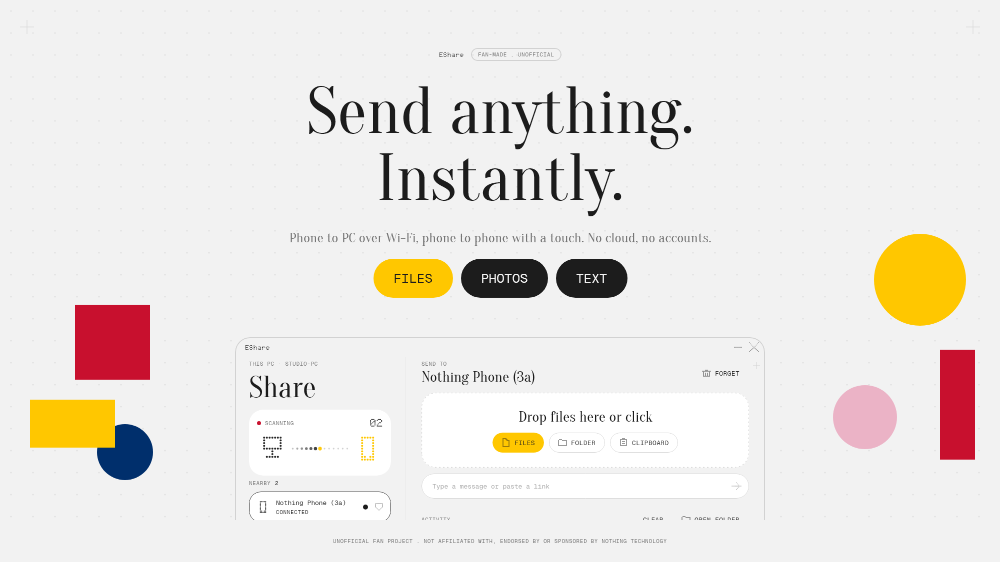

**English** | [Русский](README.ru.md)

# EShare

> **Unofficial fan project.** Made by an enthusiast, not affiliated with, endorsed by or sponsored by Nothing Technology Limited. "Nothing", "Essential" and related names belong to their owners.



Fast, private file and text sharing between Android phones and Windows PCs, styled after the Nothing / Essential look: dot-matrix captions, serif headlines, one red signal, dark theme by default.

Nothing goes through the internet or a cloud drive: the devices talk directly, so speed is limited only by your Wi-Fi.

## Features

- **Touch to share (Android ↔ Android):** hold two phones together and the files go, with a dot-matrix animation on both screens. It works with any two phones, on the same Wi-Fi or not, even when EShare is closed on the receiving phone
- **Finds devices by itself** on the same Wi-Fi (UDP beacon, no accounts)
- **Pairs once** with a 6-digit code shown on both screens (like Bluetooth); after that, transfers from paired devices are accepted automatically
- **Files, folders, photos, text and clipboard**, both directions, several files at once with a segmented progress bar and live speed
- **Android**: appears in the system share sheet; a Quick Settings tile sends the clipboard; a quiet foreground service keeps the phone reachable; files land in `Downloads/EShare`
- **Windows**: drag and drop or click to pick files, system tray, clipboard sync, right-click menu entry, start with Windows
- Dark, light or system theme; Russian and English interface


## Touch to share

Open *Share → EShare → Touch phones* (or *Touch to share* in the app) and hold the back of your phone against the other one. The files start moving and both screens play the animation.

- **How the phones find each other:** Bluetooth LE. Each phone broadcasts a tiny packet (the start of its device id, its Wi-Fi address and port). When the signal is strong enough the phones are touching. Files never go over Bluetooth.
- **Same Wi-Fi:** the usual encrypted link is opened at once.
- **No shared Wi-Fi:** the sending phone opens a Wi-Fi Direct group and asks the other phone, over Bluetooth, to join it. Android shows its own "connect to this network?" prompt the first time.
- **Receiving with the app closed:** the phone that receives only advertises itself and listens for requests while its screen is on. Allow *Display over other apps* once so the animation can appear over whatever is open. Without it you still get the normal notifications.
- **Security:** the Bluetooth packet is readable by anyone close by, so it is used only to find the phone. The connection that follows is the same mutually authenticated, encrypted one as everywhere else, and a new phone still has to be confirmed with the pairing code.

Needs Bluetooth on, and the *Nearby devices* permission on Android 12+.

## Security

Every connection is a mutually authenticated X25519 key exchange (ephemeral and static keys mixed through HKDF) followed by AES-256-GCM framing. The 6-digit pairing code is derived from the handshake, so a man in the middle shows a different code. Unpaired devices cannot send anything before both people confirm.

## Install

### Windows

1. Download `EShare-Setup.exe` from the [Releases](../../releases) page and run it. No admin rights needed: it installs to `%LOCALAPPDATA%\Programs\EShare`, adds Start menu and desktop shortcuts and an entry in *Settings → Apps*. An older "Essential Share" install is replaced and your pairings are kept.
2. On the first launch Windows Firewall asks about network access. Allow **private networks**, otherwise the PC cannot receive files.
3. Uninstall any time from *Settings → Apps*. Your settings in `%APPDATA%\EShare` are kept.

### Android (14 or newer)

1. Download `EShare.apk` from the [Releases](../../releases) page and open it (allow installing from this source if Android asks). It is signed with the same key as 1.0.0, so it updates the old app in place.
2. Open the app and allow notifications, Bluetooth and *Nearby devices*. On Android 17+ also allow access to devices on the local network.
3. For reliable background receiving, set the app's battery usage to *Unrestricted*, and allow *Display over other apps* to see the touch animation with the app closed.

### Check the files

The release files are scanned on VirusTotal. The SHA-256 of each file and its report are listed on the release page and in [VERIFY.md](VERIFY.md). You can also check a download yourself:

```
certutil -hashfile EShare.apk SHA256
```

## How to use

1. Connect the phone and the PC to the same Wi-Fi (or put the PC on the phone's hotspot). Two phones do not need a shared network for touch to share.
2. Open EShare on both. They appear in each other's list within a couple of seconds.
3. Tap / click the other device and confirm that the **same 6-digit code** is shown on both screens. This is done once.
4. Send:
   - **PC → phone:** drop files on the window, click the drop zone, or right-click a file → *Send via EShare* (on Windows 11 it is under *Show more options*).
   - **Phone → PC:** *Share → EShare* in any app, or the send button inside the app.
   - **Phone → phone:** *Touch to share*, see above.
   - **Clipboard:** the tray menu on the PC and the Quick Settings tile on the phone send the clipboard text.
5. Received files go to `Downloads/EShare` on the phone and to the save folder shown in the PC app's settings. Use *Open* / *In folder* next to a finished transfer.

If the devices do not see each other: make sure both are on the same network, that the router does not isolate wireless clients (AP isolation), and that the Windows network profile is *Private*. As a fallback, the PC app can connect by address in the form `ip:port`.

## Build from source

Requirements: JDK 17; Android SDK for the APK (put `sdk.dir=...` into `local.properties`).

```
gradlew.bat :android:assembleRelease        # android/build/outputs/apk/release
gradlew.bat :desktop:createDistributable    # desktop/build/compose/binaries/main/app
gradlew.bat :core:test                      # protocol test: pairing, 300 MB transfer, reconnect, touch
gradlew.bat :desktop:renderPreview          # renders the PC screens to PNG without a window
gradlew.bat :desktop:renderPromo            # renders the cards in docs/promo
powershell -File installer\build-installer.ps1   # wraps the app image into EShare-Setup.exe
```

The installer script uses IExpress, which ships with Windows. For a signed release APK create `keystore.properties` (git-ignored) with `storeFile`, `storePassword`, `keyAlias`, `keyPassword`; without it the release build uses the debug key.

## Layout

- `core/`: protocol, crypto, discovery, transfer engine (plain JVM, shared by both apps)
- `android/`: Jetpack Compose app (including touch to share: Bluetooth LE, Wi-Fi Direct, overlay)
- `desktop/`: Compose Desktop app
- `installer/`: per-user installer and uninstaller scripts

Not included: PC ↔ phone transfers across different networks (those two must share a Wi-Fi network or hotspot), iOS and macOS.

## Fonts

The repository ships open-licensed stand-ins (Oranienbaum, Geist Mono, MatrixSans Print, all SIL OFL) under the file names the apps expect:

- `desktop/src/main/resources/font/`: `NDot-55.otf`, `NType82-Headline.otf`, `NType82-Regular.otf`, `NType82Mono-Regular.otf`
- `android/src/main/res/font/`: `ndot_55.otf`, `ntype82_headline.otf`, `ntype82_regular.otf`, `ntype82mono_regular.otf`

Nothing's own NDot and NType typefaces are not redistributed here. If you have a licence to use them, put them over these files for the full look.

## License

MIT, see [LICENSE](LICENSE). Third-party fonts keep their own licences (SIL OFL).
